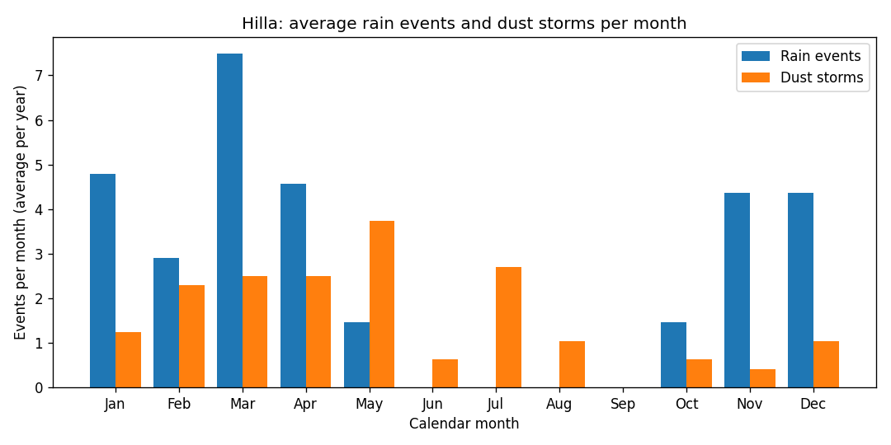
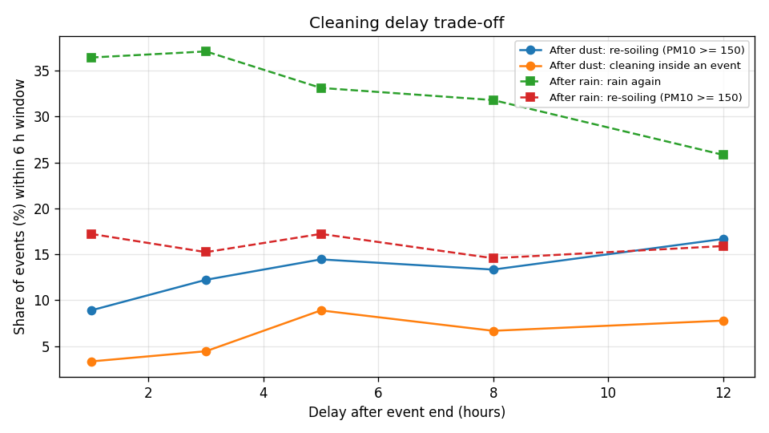
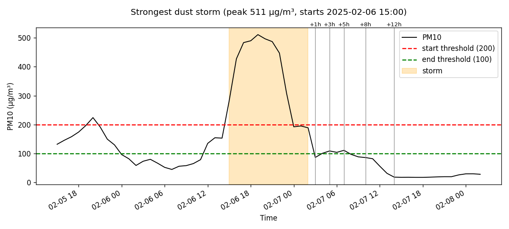

# تقرير الجزء 2 — تعريف "المطر" و"العاصفة" ومدة الانتظار

**التاريخ:** 2026-10-28 · **الحالة:** منتهٍ ✅
**مصدر البيانات:** Open-Meteo.com (CC BY 4.0) — الحلة، 2022-01 → 2026-10 (4.8 سنة)

---

## 1. لماذا هذا الجزء مهم؟
الكمبيوتر لا يفهم كلمة "عاصفة". يجب أن نعطيه **تعريفاً بالأرقام**. وكل ما بعد هذا الجزء (التدريب، الاختبار، القرار) يعتمد على هذه التعاريف.

## 2. التعاريف التي اعتمدناها
### 🌧️ حدث مطر
| القاعدة | القيمة | لماذا |
|---|---|---|
| الساعة تُعتبر ممطرة إذا | ≥ 0.1 ملم | أقل كمية تبلل اللوح |
| ساعات المطر المتقاربة تُعتبر حدثاً واحداً إذا كان بينها | ≤ ساعة جافة واحدة | المطر يأتي متقطعاً |
| نتجاهل الحدث إذا كان مجموعه | < 0.5 ملم | بيانات ERA5 معروفة بأنها تبالغ في "الرذاذ" الخفيف |

**النتيجة:** ≈ **31 حدث مطر في السنة**، مدة الحدث عادةً 3 ساعات (الأطول 24 ساعة).

### 🌪️ عاصفة غبار
| القاعدة | القيمة | لماذا |
|---|---|---|
| تبدأ العاصفة عندما PM10 | ≥ 200 | جو مغبر بشدة |
| تستمر حتى ينزل PM10 تحت | 100 | — |
| عاصفتان بينهما ≤ 3 ساعات | تُدمجان | هي نفس العاصفة |

> **لماذا رقمان (200 للبداية و 100 للنهاية) وليس رقماً واحداً؟**
> لو استعملنا رقماً واحداً، فإن الغبار عندما يتأرجح حول 200 (مثلاً 205، 195، 210) سيجعل النظام يقول "بدأت، انتهت، بدأت، انتهت" كل ساعة. استعمال رقمين يمنع هذا التذبذب. يسمى هذا **"التخلّف" (Hysteresis)**، وهو نفس الفكرة التي يعمل بها منظّم حرارة المكيّف.

**النتيجة:** ≈ **19 عاصفة في السنة**، مدة العاصفة عادةً 10 ساعات (الأطول 66 ساعة). وذروة الغبار المعتادة PM10 ≈ 249.
*(في الجزء 1 قلنا 27 في السنة. الفرق سببه أننا الآن ندمج العواصف المتقاربة، لأنها عاصفة واحدة في الحقيقة.)*

**ماذا نرى؟** المطر يكون من نوفمبر إلى أبريل، وأكثره في مارس. العواصف أكثرها في مايو، ثم فبراير–أبريل ويوليو. **سبتمبر هادئ تماماً.**

## 3. كم ننتظر بعد انتهاء الحدث؟ (جرّبنا 1، 3، 5، 8، 12 ساعة)
لكل حدث في التاريخ، تخيّلنا أننا نظّفنا بعد مدة الانتظار، ثم سألنا 3 أسئلة عن الساعات الـ 6 التالية للتنظيف:
- **هل اتسخ اللوح مجدداً؟** أي هل وصل PM10 إلى 150 أو أكثر.
- **هل أمطرت مجدداً؟**
- **هل وقع التنظيف داخل حدث جديد؟** وهذا أسوأ احتمال.

### بعد عاصفة الغبار
| الانتظار | اتسخ مجدداً | التنظيف داخل حدث جديد | الغبار وقت التنظيف (PM10) |
|---|---|---|---|
| ساعة | 8.9% | 3.3% | 91 |
| **3 ساعات** | **12.2%** | **4.4%** | **73** |
| 5 ساعات | 14.4% | 8.9% | 74 |
| 8 ساعات | 13.3% | 6.7% | 67 |
| 12 ساعة | 16.7% | 7.8% | 63 |

### بعد المطر
| الانتظار | أمطرت مجدداً | التنظيف داخل حدث جديد |
|---|---|---|
| **ساعة** | **36.4%** | **11.3%** |
| 3 ساعات | 37.1% | 17.9% |
| 5 ساعات | 33.1% | 23.8% |
| 12 ساعة | 25.8% | 21.9% |

### 🔍 الاكتشاف المهم
1. **الانتظار الأطول لا يقلل الخطر، بل يزيده قليلاً.** السبب: العواصف والأمطار تأتي متتابعة، فكلما انتظرنا أكثر زادت فرصة أن يأتي الحدث التالي.
2. **بعد العاصفة بساعة يبقى الجو مغبراً** (PM10 ≈ 91، والطبيعي ≈ 39). بعد 3 ساعات ينزل إلى ≈ 73، وبعدها يكاد لا يتحسن.
3. **للمقارنة:** في أي ساعة عادية، احتمال أن يتسخ اللوح خلال 6 ساعات هو **5.7% فقط**. أما بعد العاصفة فيصبح 9–17%. معنى ذلك أن **الخطر بعد العاصفة سببه "طقس متقلب"، وهذا لا يحلّه وقت ثابت.**

> ⚠️ **ملاحظة أمانة علمية:** عندنا 90 عاصفة فقط. فرق 3–4% بين صفين في الجدول يعني 3 أو 4 عواصف فقط، وهذا ليس فرقاً حاسماً إحصائياً.

**في هذا المثال:** بعد نهاية العاصفة بقي PM10 حوالي 100 لمدة 8 ساعات تقريباً، ثم نزل إلى 20. أي أن أفضل توقيت للتنظيف في هذه العاصفة بالذات كان بعد 12 ساعة، بينما في عواصف أخرى ساعة واحدة تكفي. **كل عاصفة مختلفة.**

## 4. القرار المعتمد
| الحالة | أقل مدة انتظار | لماذا |
|---|---|---|
| بعد المطر | **ساعة واحدة** (اختيارك) | الانتظار الأطول لا يقلل احتمال عودة المطر كثيراً (36% ← 33% بعد 5 ساعات)، لكنه يضاعف احتمال الوقوع في حدث جديد |
| بعد العاصفة | **3 ساعات** (بدل 5 المقترحة) | يقل الغبار العالق بنسبة 20%. بعد 3 ساعات لا يتحسن الجو، والخطر يزيد |

**وبعد انتهاء مدة الانتظار، لا ننظّف مباشرة.** نسأل نموذج الذكاء الاصطناعي: *"هل ستكون الساعات الست القادمة جافة وخالية من الغبار؟"*
- إذا قال **نعم** ← نرسل أمر التنظيف.
- إذا قال **لا** ← ننتظر ونسأله مجدداً كل ساعة.

**وهنا بالضبط دور الذكاء الاصطناعي:** الوقت الثابت أعمى، أما النموذج فيختار **اللحظة المناسبة** لكل عاصفة.

## 5. الملفات الناتجة
- `define_events.py` — البرنامج (كتبه الوكيل `builder`، وراجعته الجلسة الرئيسية)
- `data/processed/hilla_events.csv` — قائمة بكل حدث: نوعه، بدايته، نهايته، ذروته
- `data/processed/hilla_hourly_labeled.csv` — الجدول الساعي مع عمودين جديدين: `is_rain` و `is_dust_storm`
- `data/processed/events_report.txt` — التقرير الرقمي
- `reports/charts/*.png` — 3 رسوم جاهزة للأطروحة

كل الأرقام أعلاه (200، 100، 3 ساعات...) موجودة في أول البرنامج، وتغييرها سهل.

## 6. الخطوة التالية
**الجزء 3:** نبني نموذجين ونقارن بين خوارزميتين، Random Forest و Gradient Boosting (عائلة XGBoost):
- **نموذج المطر:** ما احتمال المطر في الساعات الست القادمة؟
- **نموذج الغبار:** ما احتمال أن يصل PM10 إلى 150 أو أكثر في الساعات الست القادمة؟
