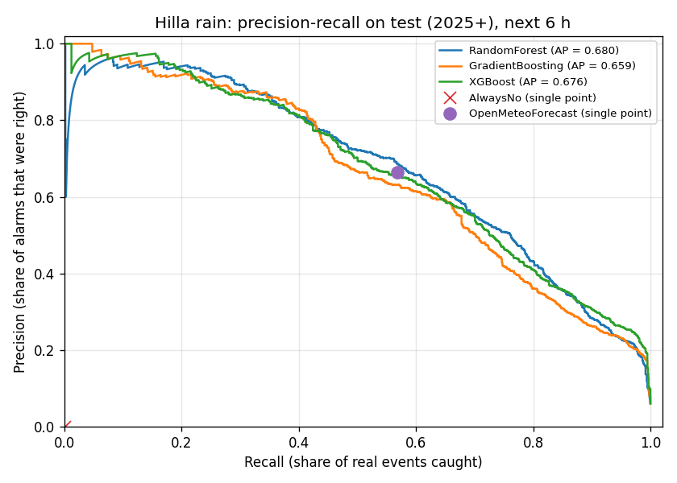
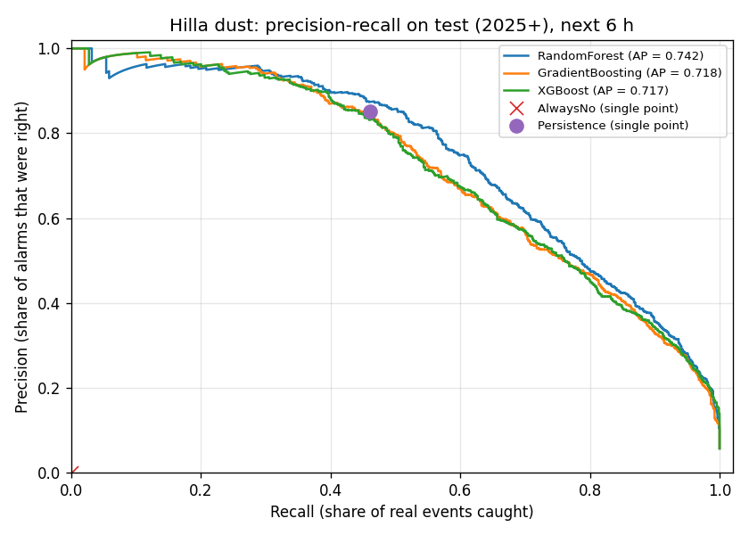
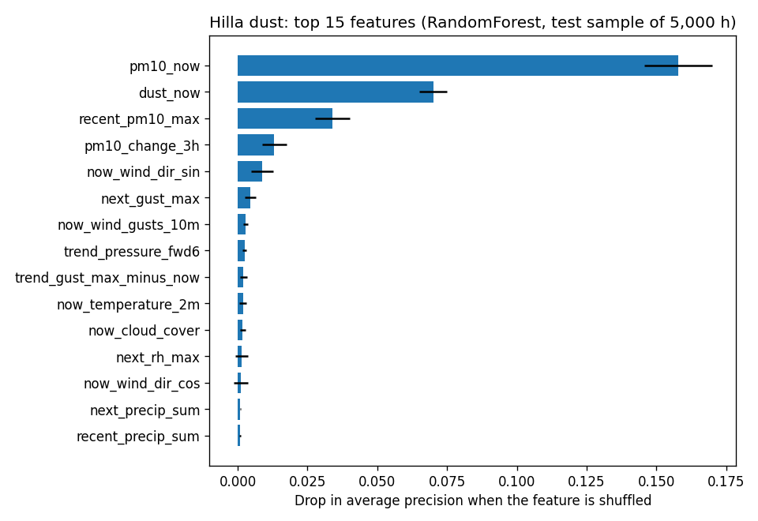

# تقرير الجزء 3 — بناء النموذجين ومقارنة 3 خوارزميات

**التاريخ:** 2026-10-28 · **الحالة:** منتهٍ ✅
**مصدر البيانات:** Open-Meteo.com (CC BY 4.0) — الحلة

---

## 1. ماذا بنينا؟
نموذجان، كل واحد يجيب عن سؤال واحد في **أي ساعة**:
| النموذج | السؤال | "الجواب الصحيح" الذي تعلّم منه |
|---|---|---|
| 🌧️ المطر | هل ستمطر (≥ 0.1 ملم) في الـ 6 ساعات القادمة؟ | ERA5 (ما حدث فعلاً) |
| 🌪️ الغبار | هل سيصل PM10 إلى ≥ 150 في الـ 6 ساعات القادمة؟ | CAMS (الغبار) |

**المدخلات (29 "دليلاً"):** فقط ما يعرفه النظام **فعلاً** لحظة القرار:
- توقعات الطقس الآن وللساعات الست القادمة (المطر، الغيوم، الرياح، الضغط، الرطوبة، الحرارة).
- الغبار الآن وفي آخر 6 ساعات.
- الساعة واليوم من السنة.

> **لماذا هذا مهم؟** لو أعطينا النموذج "ما حدث فعلاً" كمدخل، سيحصل على درجات عالية جداً في الاختبار، لكنه سيفشل في الحقل لأن هذه المعلومة لن تكون موجودة وقتها. هذا الخطأ اسمه **"تسرّب البيانات" (Data Leakage)**. تأكدنا من غيابه بفحص تلقائي داخل البرنامج.

## 2. كيف كانت المقارنة عادلة؟
قسّمنا البيانات **حسب الزمن**، ولم نخلطها عشوائياً، لأن النموذج في الحقيقة سيتوقع المستقبل دائماً:
| المرحلة | الفترة | الغرض |
|---|---|---|
| تدريب | 2022–2023 | النموذج يتعلم |
| تحقق | 2024 | نختار الفائز ونضبط "حساسية الإنذار" |
| **اختبار** | **2025–2026** | **امتحان نهائي على بيانات لم يرها أحد** |

- الخوارزميات الثلاث أخذت **نفس البيانات ونفس المدخلات** بالضبط.
- الفائز اخترناه بنتائج 2024، **وليس** بنتائج الامتحان النهائي، حتى لا "نغش".

## 3. النتائج (الامتحان النهائي 2025–2026)
**طريقة قراءة الجدول:**
- **الدقة (Precision):** عندما يقول النموذج "سيحدث"، كم مرة يكون محقاً؟
- **الاستدعاء (Recall):** من كل الأحداث الحقيقية، كم حدثاً اكتشف النموذج؟
- **F1:** درجة واحدة تجمع الاثنين (من 0 إلى 1)، وهي **أهم رقم** هنا.
- **AP:** جودة النموذج على كل مستويات الحساسية (من 0 إلى 1).

### 🌧️ المطر
| الطريقة | Accuracy | Precision | Recall | **F1** | **AP** | الحجم |
|---|---|---|---|---|---|---|
| **Random Forest** 🏆 | 95.7% | 0.66 | 0.60 | **0.626** | **0.680** | 8.4 MB |
| XGBoost | 95.6% | 0.65 | 0.58 | 0.613 | 0.676 | 1.0 MB |
| Gradient Boosting | 95.4% | 0.63 | 0.57 | 0.599 | 0.659 | 1.5 MB |
| نشرة Open-Meteo وحدها (بلا ذكاء) | 95.6% | 0.67 | 0.57 | 0.613 | — | — |
| "قل دائماً: لا مطر" | **93.9%** | 0 | 0 | 0 | — | — |

### 🌪️ الغبار
| الطريقة | Accuracy | Precision | Recall | **F1** | **AP** | الحجم |
|---|---|---|---|---|---|---|
| **Random Forest** 🏆 | 94.9% | 0.54 | **0.76** | **0.631** | **0.742** | 10.1 MB |
| XGBoost | 95.5% | 0.59 | 0.67 | 0.629 | 0.717 | 1.1 MB |
| Gradient Boosting | 94.9% | 0.54 | 0.71 | 0.611 | 0.718 | 1.5 MB |
| "الغبار الآن ≥ 150" (بلا ذكاء) | 96.5% | 0.85 | 0.46 | 0.599 | — | — |
| "قل دائماً: لا غبار" | **94.3%** | 0 | 0 | 0 | — | — |

## 4. ماذا تعني هذه النتائج؟
### ⚠️ فخ "الدقة 99%"
انظر إلى سطر **"قل دائماً: لا"**: نموذج غبي لا يفعل شيئاً حصل على **94% Accuracy**. السبب أن المطر والغبار نادران، فهما يحدثان في 5–6% فقط من الساعات. لذلك:
- **رقم Accuracy لا قيمة له في مشروعنا.** نموذج يقول "لا" دائماً يحصل على 94%، ونموذج "يحفظ" البيانات قد يصل إلى 99% وهو عديم الفائدة.
- لجنة المناقشة ستسأل عن **F1 و Recall**. لا تذكر Accuracy وحدها أبداً.

### الخوارزميات الثلاث متقاربة جداً
الفرق بين الأفضل والأسوأ **0.02–0.03 فقط**. معنى ذلك أن **الحد الأقصى للدقة لا تحدده الخوارزمية، بل المعلومات الموجودة في المدخلات**. نشرة الطقس نفسها تخطئ أحياناً، ولا يستطيع أي نموذج أن يعرف ما لا تحتويه المدخلات.

### هل يتفوق الذكاء الاصطناعي على الطرق البسيطة؟
- **المطر:** نعم، لكن **بفارق صغير** (F1 0.626 مقابل 0.613).
- **الغبار:** نعم (F1 0.631 مقابل 0.599). الأهم أن النموذج **يكتشف 76% من العواصف القادمة** مقابل 46% للطريقة البسيطة.
- **ميزة إضافية لا تظهر في الجدول:** الطريقة البسيطة تعطي "نعم/لا" فقط. أما النموذج فيعطي **احتمالاً** (مثلاً 23%)، وهذا يسمح لنا بضبط الحساسية: هل نفضل "لا نفوّت أي عاصفة" أم "لا نهدر الماء"؟ هذا ما يحتاجه صانع القرار في الجزء 5.

### ما الذي يعتمد عليه النموذجان؟

- **الغبار:** أهم دليل هو **الغبار الآن**، ثم اتجاه الرياح وهبّاتها. وهذا منطقي فيزيائياً: الغبار يستمر، والرياح تحمله.
- **المطر:** أهم دليل هو **توقع المطر نفسه**، ثم الغيوم والهبّات. النموذج يتعلم **متى يصدّق النشرة ومتى يشك فيها**.

## 5. الفائز والأفضل للعمل
| المعيار | الفائز |
|---|---|
| الأدق في المطر والغبار | **Random Forest** |
| الأصغر والأسرع | XGBoost (أصغر 8 مرات، وأسرع 5 مرات) |
| السرعة في الاستعمال الفعلي | كلها تكفي وتزيد: أقل من 5 أجزاء من الألف من الثانية للقرار الواحد |

**القرار: Random Forest للنموذجين.** هو الأدق، وحجمه 10 MB لا يمثل مشكلة على سيرفر. وإذا احتجنا لاحقاً نموذجاً أصغر (مثلاً لتخزينه على GitHub يومياً)، فـ XGBoost بديل جاهز يكاد لا يخسر شيئاً من الدقة.

## 6. حدود يجب ذكرها في الأطروحة (Limitations)
1. **"الحقيقة" ليست قياساً على اللوح:** ERA5 للمطر و CAMS للغبار هي إعادة تحليل عالمية، وليست حساساً في الموقع. هذا مقبول لأن المشروع "بلا حساسات"، لكنه حد يجب ذكره.
2. **أرشيف التوقعات متفائل قليلاً:** أرشيف Open-Meteo يجمع أحدث توقع متاح لكل ساعة. في الحقل الفعلي قد يكون التوقع أقدم بساعات قليلة، فتكون الدقة الحقيقية أقل قليلاً.
3. **فترة الاختبار قصيرة نسبياً:** 1.8 سنة، فيها حوالي 90 حدث مطر وحوالي 35 عاصفة.

## 7. الملفات
- `train_models.py` — البرنامج (كتبه الوكيل `builder`، وراجعته الجلسة الرئيسية للتأكد من غياب التسرّب)
- `models/rain_model.joblib`, `models/dust_model.joblib` — النموذجان المدرَّبان
- `reports/model_comparison.csv` — كل الأرقام في جدول
- `data/processed/train_report.txt` — التقرير الرقمي
- `reports/charts/` — 4 رسوم جديدة

لإعادة التدريب: `python train_models.py` (يستغرق حوالي 40 ثانية).
