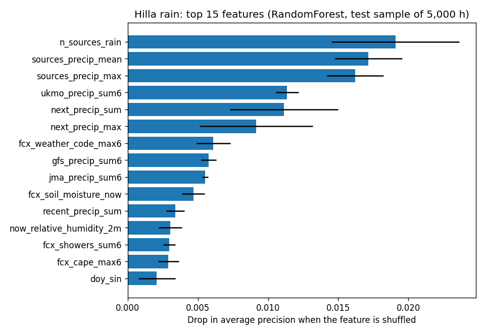
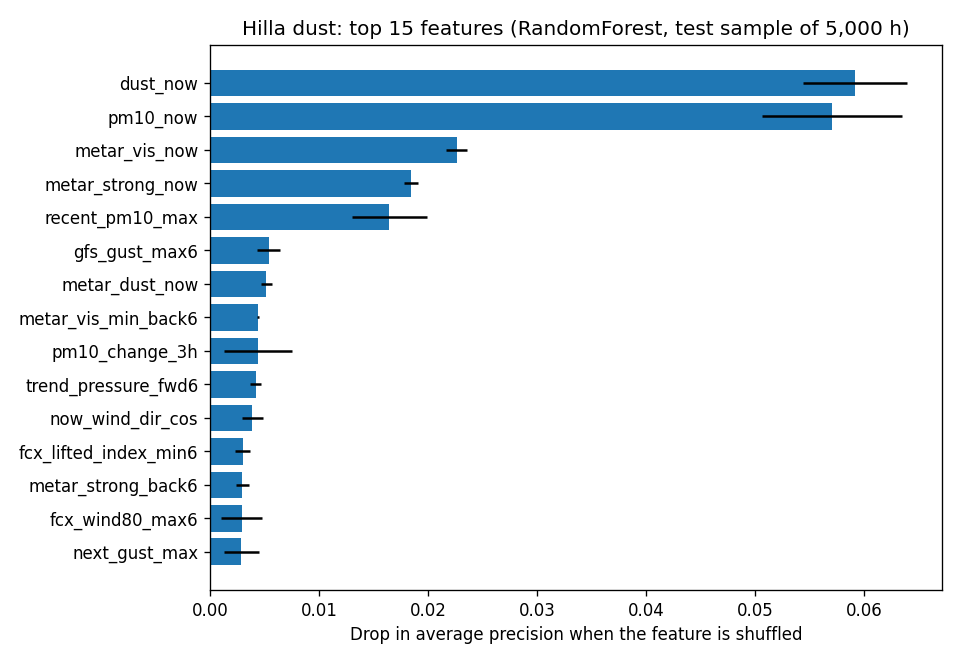

# تقرير جولة التحسين (3ب) — معلومات أكثر من عدة مراكز طقس

**التاريخ:** 2026-10-28 · **الحالة:** منتهٍ ✅ · **الموقع:** الحلة فقط
**مصدر البيانات:** Open-Meteo.com (CC BY 4.0)

---

## 1. الفكرة
في الجزء 3 وجدنا أن الخوارزميات الثلاث متقاربة جداً. معنى ذلك أن **الحد هو المعلومات وليس الخوارزمية**. لذلك أعطينا النماذج معلومات أكثر بدل أن نغيّر الخوارزمية.

## 2. ماذا أضفنا؟ (22 دليلاً جديداً، فصار المجموع 51)
### أ) متغيرات جديدة من النشرة الرئيسية
| المتغير | لماذا يفيد |
|---|---|
| **نوع الطقس** (weather_code) | يميّز "رذاذ" عن "عاصفة رعدية" |
| **طاقة السحب** (CAPE) و**مؤشر عدم الاستقرار** (Lifted Index) | يقيسان قابلية الجو لتكوين أمطار رعدية |
| **الزخّات** (showers) | المطر المتقطع القصير |
| **مدى الرؤية** (visibility) | ينخفض في الغبار |
| **رطوبة التربة** | التربة الجافة يرفعها الهواء غباراً بسهولة أكبر |
| **الرياح على ارتفاع 80 م** | الرياح العليا تحمل الغبار من مسافات بعيدة |
| **الفرق بين الحرارة ونقطة الندى** | كلما صغُر هذا الفرق اقترب الجو من التشبع بالرطوبة |

### ب) "رأي ثانٍ وثالث ورابع": 3 مراكز طقس أخرى
| المركز | الدولة | متوفر منذ |
|---|---|---|
| GFS | أمريكا 🇺🇸 | 2022-01 |
| UKMO | بريطانيا 🇬🇧 | 2022-03 |
| JMA | اليابان 🇯🇵 | 2022-01 |

جرّبنا أيضاً المركز الأوروبي ECMWF والألماني ICON، لكنهما **لا يتوفران إلا منذ 2023–2024**، وهذا تاريخ قصير لا يكفي للتدريب، فاستبعدناهما.

**ومن هذه المراكز صنعنا "أدلة اتفاق"، مثل:** *كم مركزاً من الأربعة يتوقع مطراً؟* ← إذا اتفق 4 من 4 فالمطر شبه مؤكد، وإذا قال مركز واحد فقط فهو مشكوك فيه.

## 3. النتائج: قبل وبعد (نفس الامتحان: 2025–2026)
### 🌧️ المطر — تحسن واضح
| | قبل | **بعد** | التغيّر |
|---|---|---|---|
| F1 | 0.626 | **0.674** | **+8%** |
| يكتشف من الأمطار الحقيقية (Recall) | 60% | **71%** | +11 نقطة |
| صدق الإنذار (Precision) | 66% | 64% | ≈ |
| AP | 0.680 | **0.752** | +0.07 |
| **مقارنة بنشرة Open-Meteo وحدها** (F1 0.613) | +2% | **+10%** | |

**بالكلام البسيط:** نشرة الطقس وحدها تكتشف **57%** من الأمطار القادمة، ونموذجنا الآن يكتشف **71%** منها، وصدق إنذاره تقريباً بنفس المستوى.

### 🌪️ الغبار — تحسن صغير
| | قبل | **بعد** |
|---|---|---|
| F1 | 0.631 | **0.653** |
| صدق الإنذار (Precision) | 54% | **61%** |
| يكتشف من العواصف (Recall) | 76% | 71% |
| AP | 0.742 | 0.747 |

**لماذا التحسن في الغبار صغير؟** لأن أقوى دليل على الغبار القادم هو **الغبار الموجود الآن**، وهذا كان متاحاً للنموذج من قبل. والمراكز الأخرى لا تتوقع الغبار نفسه، بل الرياح فقط.

### الخوارزميات الثلاث بعد التحسين
| | Random Forest | XGBoost | Gradient Boosting |
|---|---|---|---|
| مطر F1 | **0.674** 🏆 | **0.674** | 0.666 |
| غبار F1 | **0.653** 🏆 | 0.636 | 0.560 |

**Random Forest ما زال الفائز** في المطر والغبار. اخترناه بنتائج 2024 وليس بنتائج الامتحان النهائي، حتى تبقى المقارنة عادلة.

## 4. ما الذي ساعد فعلاً؟


**أهم 3 أدلة للمطر صارت كلها "أدلة اتفاق المراكز":**
1. عدد المراكز التي تتوقع مطراً.
2. متوسط المطر المتوقع من المراكز.
3. أكبر كمية مطر يتوقعها أي مركز.

**هذا اكتشاف جيد للأطروحة:** النموذج تعلّم بنفسه فكرة **"حكمة المجموعة"**، أي أن اتفاق عدة مراكز طقس أوثق من رأي مركز واحد. وهذه نفس الفكرة التي يستعملها خبراء الأرصاد الجوية، ويسمونها "Ensemble".



**الغبار:** الغبار الآن ما زال الأهم، وأضيفت إليه **هبّات الرياح القادمة حسب GFS**.

## 5. القرار
**نعتمد النموذجين المحسَّنين (Random Forest + 51 دليلاً)** في مجلد `models/extended/`. أما النموذجان القديمان فيبقيان في `models/` للمقارنة في الأطروحة.

**نتيجة عملية لهذا القرار:** في التشغيل الفعلي، يجب أن يجلب النظام كل ساعة بيانات من **4 مصادر** (النشرة الرئيسية + GFS + UKMO + JMA) بدل مصدر واحد. كلها مجانية من Open-Meteo، وسنبني ذلك في الجزء 6.

## 6. حدود يجب ذكرها في الأطروحة
- **المقارنة ليست متطابقة 100%:** النموذج المحسَّن تدرّب على بيانات أقل بشهرين، لأنه يبدأ من 2022-03 بسبب UKMO. وهذا في صالح التحسين، لأنه تفوّق رغم البيانات الأقل.
- **"الجواب الصحيح" ليس قياساً على اللوح:** ما زال من ERA5 و CAMS، كما في الجزء 3.

## 7. الملفات
| الملف | ما الذي حدث |
|---|---|
| `download_extra.py` | **جديد:** ينزّل المصادر الأربعة |
| `data/raw_hilla_extra/` | **جديد:** fcx, gfs, ukmo, jma (42,120 ساعة لكل منها) |
| `prepare_data.py` | **عُدِّل:** يدمج البيانات الإضافية إن وُجدت |
| `train_models.py` | **عُدِّل:** خيار `--extended` |
| `models/extended/` | **جديد:** النموذجان المعتمدان |
| `reports/model_comparison_extended.csv` | **جديد:** كل الأرقام |
| `reports/charts/*_extended.png` | **جديد:** 4 رسوم |

لإعادة كل الجولة:
```
python download_extra.py
python prepare_data.py
python define_events.py
python train_models.py --extended
```
