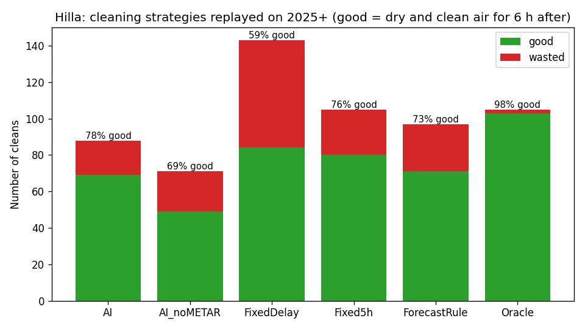
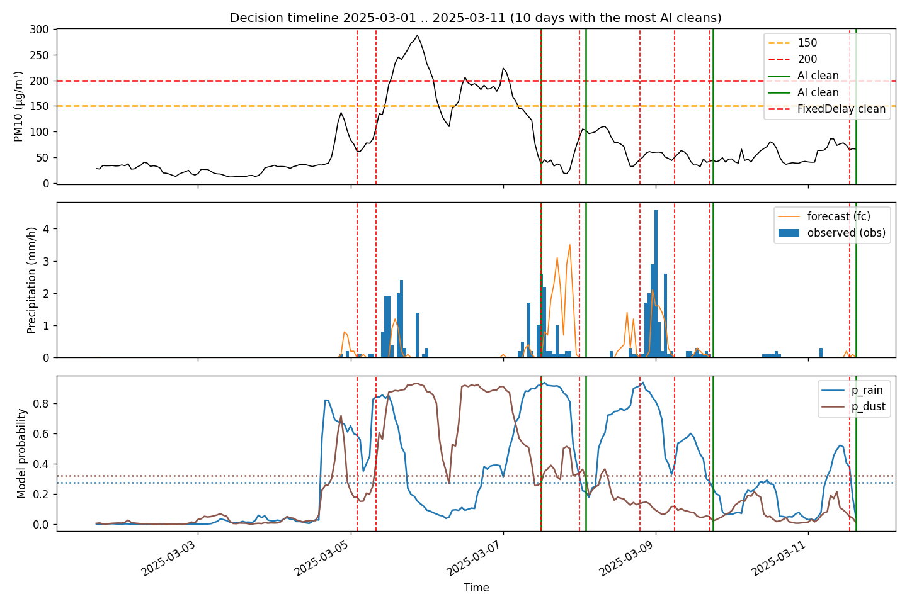

# تقرير الجزء 4 — اختبار نظام القرار كاملاً (محاكاة 2025–2026)

**التاريخ:** 2026-10-29 · **الحالة:** منتهٍ ✅ · **الموقع:** الحلة
**مصدر البيانات:** Open-Meteo.com (CC BY 4.0)

---

## 1. ماذا فعلنا؟
شغّلنا النظام **ساعة بساعة** على 22 شهراً (15,810 ساعة، من يناير 2025 إلى أكتوبر 2026) كأنه كان مركّباً في الحقل:
- **ماذا رأى النظام؟** فقط ما كان سيراه فعلاً في وقته: النشرة الجوية ومستوى الغبار في تلك الساعة.
- **كيف حكمنا على كل غسلة؟** بما حدث **فعلاً** بعدها:
  - ✅ **غسلة مفيدة:** لم تمطر ولم يتجاوز الغبار 150 خلال الساعات الـ 6 التالية.
  - ❌ **غسلة مهدورة:** اتسخ اللوح أو تبلل خلال 6 ساعات، فذهب الماء سدى.

**"عقل القرار" (`decision.py`) مكتوب مرة واحدة:** نفس الملف سيستعمله السيرفر في الحقل، فلا يمكن أن يختلف ما اختبرناه هنا عمّا سيعمل فعلياً.

## 2. الطرق الخمس التي قارنّاها
كلها تطبّق **نفس قواعد الأمان**: لا غسيل أثناء المطر أو العاصفة، وحد أقصى غسلتان في اليوم، و6 ساعات بين كل غسلتين.

| الطريقة | كيف تقرر |
|---|---|
| **🤖 الذكاء الاصطناعي** | تنتظر الحد الأدنى (ساعة بعد المطر، 3 ساعات بعد العاصفة)، ثم **تسأل النموذجين** هل الساعات الست القادمة آمنة |
| قواعد ثابتة | تنظّف مباشرة بعد ساعة أو 3 ساعات، **دون أي سؤال** (هذه "أتمتة" وليست ذكاءً) |
| انتظار 5 ساعات | فكرتك الأولى: 5 ساعات بعد أي حدث |
| قاعدة النشرة | تسأل النشرة مباشرة: هل يُتوقع مطر؟ وهل الغبار الآن ≥ 150؟ (ذكية، لكن **بلا تعلّم آلي**) |
| 🔮 العرّاف | يعرف المستقبل بدقة كاملة. **مستحيل في الواقع**، لكنه يبيّن الحد الأعلى الممكن |

## 3. النتائج

| الطريقة | غسلات في 22 شهراً | ✅ مفيدة | ❌ مهدورة | **نسبة الغسلات المفيدة** |
|---|---|---|---|---|
| **🤖 الذكاء الاصطناعي** | **73** | 54 | **19** | **74%** |
| قاعدة النشرة | 80 | 54 | 26 | 68% |
| انتظار 5 ساعات | 90 | 59 | 31 | 66% |
| قواعد ثابتة | 130 | 65 | **65** | 50% |
| 🔮 العرّاف (مستحيل) | 89 | 89 | 0 | 100% |

### ماذا تعني بالكلام البسيط؟
**مقارنة بالقواعد الثابتة (أتمتة بلا ذكاء):**
- 💧 **غسلات أقل بـ 44%**: حوالي 40 غسلة في السنة بدل 71، أي ماء أقل وتآكل أقل للمضخة والفرش.
- 🗑️ **الغسلات المهدورة أقل بـ 71%**: انخفضت من 65 إلى 19.
- النتيجة: **3 من كل 4 غسلات مفيدة**، بدلاً من غسلة مفيدة من كل غسلتين.

**مقارنة بقاعدة النشرة (ذكية لكن بلا تعلّم آلي):**
- نفس عدد الغسلات المفيدة (54)، لكن **الغسلات المهدورة أقل بـ 27%** (19 بدل 26).
- ← **هذا هو الدليل على أن التعلّم الآلي يضيف قيمة حقيقية فوق القواعد الذكية**، وهي الجملة التي تحتاجها أطروحتك.

**مقارنة بفكرة الـ 5 ساعات:** الذكاء الاصطناعي أفضل (74% مقابل 66%)، وبغسلات أقل.

## 4. الثمن: الانتظار أطول قليلاً
كم ساعة يبقى اللوح متسخاً منذ أول حدث حتى الغسلة؟

| الطريقة | المعتاد (الوسيط) | في 90% من الحالات أقل من | الأطول | انتظارات أكثر من يومين |
|---|---|---|---|---|
| قواعد ثابتة | 5 ساعات | 16 ساعة | 47 ساعة | 0 |
| **🤖 الذكاء الاصطناعي** | **10 ساعات** | 32 ساعة | 77 ساعة | 4 |
| 🔮 العرّاف | 8 ساعات | 31 ساعة | 77 ساعة | 1 |

**الملاحظة المهمة:** حتى العرّاف الذي يعرف المستقبل **ينتظر بنفس القدر تقريباً**. معنى ذلك أن انتظار الذكاء الاصطناعي **ليس خطأ**: عندما يكون الطقس متقلباً لعدة أيام، لا يوجد وقت آمن للغسل أصلاً. القواعد الثابتة "أسرع" فقط لأنها تغسل في وقت غير مناسب، فتهدر نصف غسلاتها.

## 5. مثال حقيقي: 10 أيام من أبريل–مايو 2025

- **اللوحة العليا:** مستوى الغبار.
- **الوسطى:** المطر.
- **السفلى:** احتمالات النموذجين.
- **الخطوط العمودية:** الخضراء غسلات الذكاء الاصطناعي، والحمراء المتقطعة غسلات القواعد الثابتة.

في 4 و5 مايو كان الغبار يتأرجح والمطر الخفيف يظهر ويختفي. القواعد الثابتة غسلت **مرتين إضافيتين** في وقت كان احتمال الغبار فيه مرتفعاً، أما النموذج فانتظر حتى انخفض الاحتمال.

## 6. حدود يجب ذكرها في الأطروحة
1. **8 غسلات من 73 وقعت والمطر ينزل فعلاً،** لكن النشرة قالت "جاف". السبب أن النظام بلا حساسات، فيعتمد على النشرة لمعرفة "هل تمطر الآن؟". *(حساس مطر رخيص سيحل هذا، لكنه خارج شرط "بلا حساسات".)*
2. **"المفيدة" و"المهدورة" تقدير بالبيانات** (ERA5 و CAMS)، وليست قياساً لنظافة اللوح أو إنتاج الكهرباء. القياس الحقيقي يكون في الحقل، بمقارنة إنتاج اللوح قبل الغسلة وبعدها.
3. **المحاكاة على 22 شهراً فقط** (73 غسلة). الفروق كبيرة وواضحة، لكن عدد الحالات محدود.

## 7. قاعدة "أقصى انتظار 48 ساعة" (أُضيفت بموافقة صاحب المشروع ✅)
**القاعدة:** إذا بقي اللوح متسخاً 48 ساعة منذ أول حدث، والنموذج ما زال يقول "غير آمن"، نغسل مع ذلك.
- القاعدة لا تسمح أبداً بالغسيل **أثناء** مطر أو عاصفة.
- القاعدة تحترم دائماً حد الغسلتين في اليوم وفاصل الـ 6 ساعات.

| AI | قبل القاعدة | **بعد القاعدة** |
|---|---|---|
| الغسلات | 73 | 74 |
| مفيدة | 74% | **71.6%** |
| مهدورة | 19 | 21 |
| غسلات أجبرتها القاعدة | — | 3 |

**الثمن:** غسلتان مهدورتان إضافيتان في 22 شهراً. **المقابل:** اللوح لا يبقى متسخاً بسبب "تردد" النموذج أكثر من يومين.
*(الانتظارات الأطول من 48 ساعة التي بقيت كلها حصلت والعاصفة أو المطر ما زال مستمراً، وهذا صحيح، لأن الغسل أثناء الحدث ممنوع.)*

**ما زال الذكاء الاصطناعي الأفضل:** 71.6% مقابل 67.5% لقاعدة النشرة و50% للقواعد الثابتة.

## 8. الملفات
| الملف | ما هو |
|---|---|
| `decision.py` | **عقل القرار**: القواعد + حدود الأمان + اختبار ذاتي (`python decision.py`) |
| `simulate_decisions.py` | المحاكاة (`python simulate_decisions.py`) |
| `data/processed/decisions_2025_2026.csv` | كل غسلة لكل طريقة: الوقت والسبب والنتيجة |
| `data/processed/simulation_report.txt` | التقرير الرقمي |
| `reports/charts/strategy_comparison.png`, `decision_timeline.png` | الرسمان |

كتب الوكيل `builder` الملفين. أنا راجعت كود القرار سطراً سطراً مقابل القواعد المتفق عليها، وأضفت قياس "مدة الانتظار من أول حدث" لأن المقياس الأصلي كان مضللاً.
